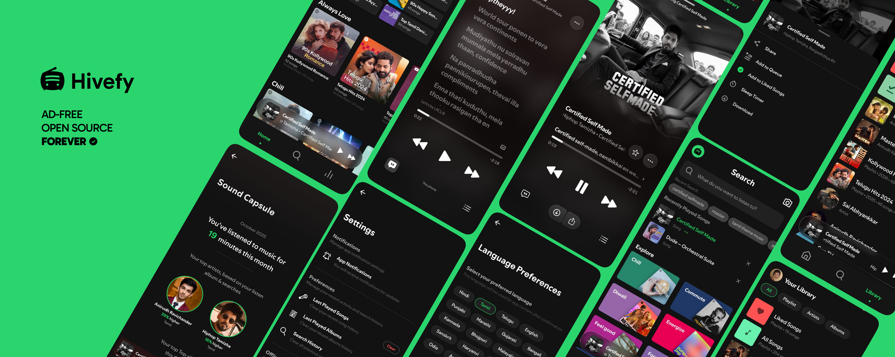
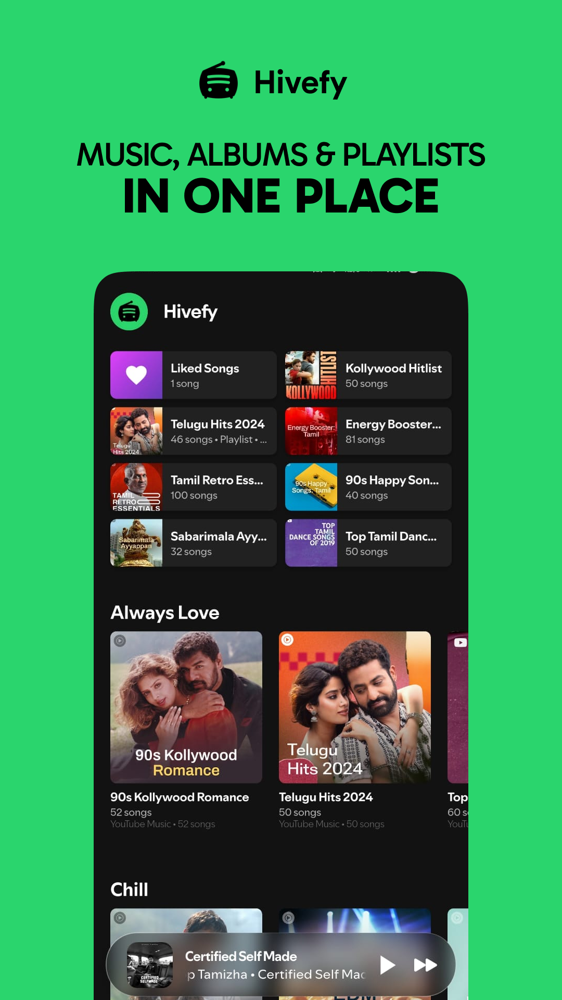
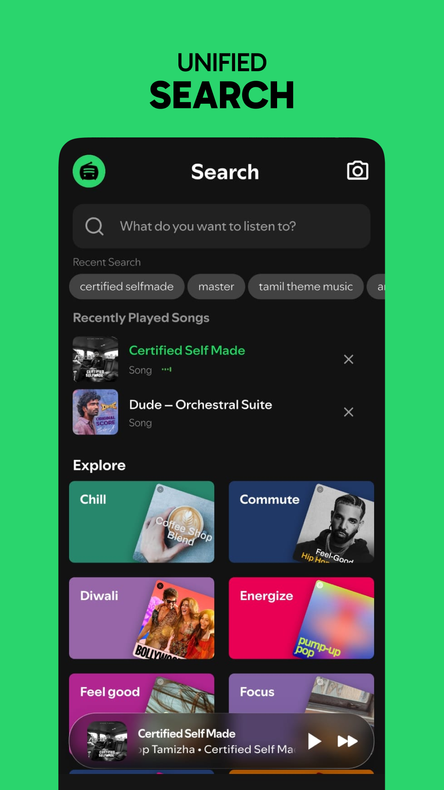
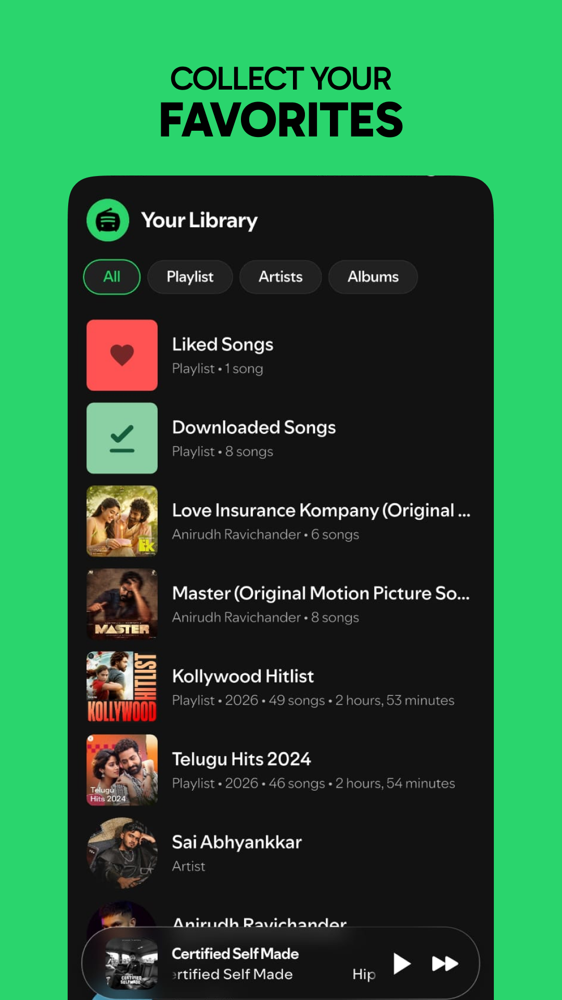

<h1 align="center">Hivefy 🎧</h1>

<p align="center"><strong>A free YouTube Music client with a familiar Spotify-inspired interface and an iOS-style player.</strong></p>

<p align="center">

  <!-- 🔹 GitHub Downloads -->
  <a href="https://github.com/Harish-Srinivas-07/hivefy/releases/latest">
    
  </a>

  <!-- 🔹 SourceForge Downloads -->
  <a href="https://sourceforge.net/projects/hivefy/files/">
    
  </a>

  <!-- 🔹 GitHub Latest Release -->
  <a href="https://github.com/Harish-Srinivas-07/hivefy/releases/latest">
    
  </a>
  <!-- 🔹 Built With / Platform / Open Source -->
  
  
  
  
  
</p>

**Hivefy** is a free, open-source **YouTube Music client for Android and iOS**, built with Flutter. Discover and play music in a familiar, Spotify-inspired interface with a sleek, iOS-style music player. Search songs, artists, albums, and playlists, follow synced lyrics, and save music for offline listening. Hivefy is an independent project and is not affiliated with YouTube or Google.

<p>
  <a href="https://github.com/Harish-Srinivas-07/hivefy/releases/latest">
    
  </a>
  &nbsp;&nbsp;
  <a href="https://sourceforge.net/projects/hivefy/" target="_blank">
    
  </a>
</p>

<h3>Download for Android 😍</h3>

<!-- GitHub button -->
<p>
  <a href="https://github.com/Harish-Srinivas-07/hivefy/releases" target="_blank">
    
  </a>
</p>

<!-- SourceForge button -->
<p>
  <a href="https://sourceforge.net/projects/hivefy/" target="_blank">
    
  </a>
</p>

> **Install note:** Android may ask you to allow app installs from your browser or file manager when installing the APK.

## ✨ Features

### 🎨 Spotify-Inspired Design

- Familiar dark interface with animated navigation and player transitions
- iOS-style full-screen music player and mini-player
- Dynamic color theming where supported

### 🎧 Music Playback

- Background playback and system media controls
- Playback queue, shuffle, repeat, seeking, and output selection
- Synced lyrics with provider selection and timing adjustment
- Mini-player and full-screen player

### 💾 Downloads & Library

- Save songs and albums for offline playback
- Browse liked songs, downloads, playlists, and other saved music
- Track download progress and manage saved files

### 🔍 Search & Discovery

- Search songs, albums, artists, and playlists
- Explore recommendations based on your selected languages
- Recently played items and search history

### 👤 Profile & Settings

- Set a local profile name and photo
- Sound Capsule listening highlights
- Manage language preferences, notifications, storage, and cache

### 📱 Platform Support

- Android
- iOS 15 and later

> **iOS availability:** The iOS build is prepared, but no installable public release is currently available. Apple requires apps to be signed and provisioned before they can be installed on iOS devices.

## 🖼️ Screenshots

<p align="center">
  
  
  
</p>
<p align="center">
  
  
</p>

## 🧠 Roadmap

- [ ] 🧠 AI-based recommendations
- [ ] ☁️ Cloud profile sync
- [ ] 🖥️ Windows app support
- [ ] 🤝 Playlist sharing & collaboration

## 🚀 Getting Started

### Prerequisites

- Flutter SDK with Dart **>3.10.0 and <4.0.0**
- Android Studio or VS Code with Flutter support
- Java JDK **17 or later** for Android builds
- macOS with Xcode to build for iOS (deployment target: iOS 15)

### Setup & Run

```bash
git clone https://github.com/Harish-Srinivas-07/hivefy.git
cd hivefy
flutter pub get
flutter run
```

## 🧩 Tech Stack

| Category    | Packages                                                                           |
| ----------- | ---------------------------------------------------------------------------------- |
| **State**   | `flutter_riverpod`                                                                 |
| **Audio**   | `just_audio`, `audio_service`, `just_audio_background`                             |
| **Storage** | `hive`, `shared_preferences`, `path_provider`                                      |
| **UI/UX**   | `shimmer`, `cached_network_image`, `figma_squircle`, `flashy_tab_bar2`, `readmore` |
| **Network** | `dio`, `http`, `html_unescape`                                                     |
| **System**  | `flutter_local_notifications`, `disk_space_plus`, `package_info_plus`              |
| **Utils**   | `toastification`, `permission_handler`, `internet_connection_checker_plus`         |

## 💡 Project Structure

- App screens and feature flows: `lib/screens/`
- Reusable UI components: `lib/components/`
- Service integrations and application logic: `lib/services/`
- Data models and persistence: `lib/models/`

---

## ❤️ Contributing

Contributions, bug reports, and feature ideas are welcome. To contribute, fork the repository, create a branch, and make your changes:

```bash
git checkout -b feature/your-change

flutter pub get
flutter run
```

Then open a pull request with a clear summary of your changes.

---

<div align="center">

<h1><a id="disclaimer"></a>Disclaimer &amp; Legal Notice</h1>

Hivefy is an independent music player. It is **not affiliated with, endorsed by, or connected to YouTube or Google**.

- **Media and downloads:** Hivefy does not host or upload music. It accesses third-party services and stores user-requested downloads on the device for offline playback.
- **Third-party services:** Availability, content, and service behavior may change. Hivefy cannot guarantee uninterrupted access.
- **User responsibility:** Users are responsible for following applicable laws and the terms of services they use.
- **License:** Hivefy is free software under the GPL-3.0 license. See [`LICENSE`](./LICENSE) for details.

</div>

---

## ⭐ Star the Repo

If Hivefy is useful to you, support the project by starring it on GitHub. Your feedback and contributions help the project grow.
